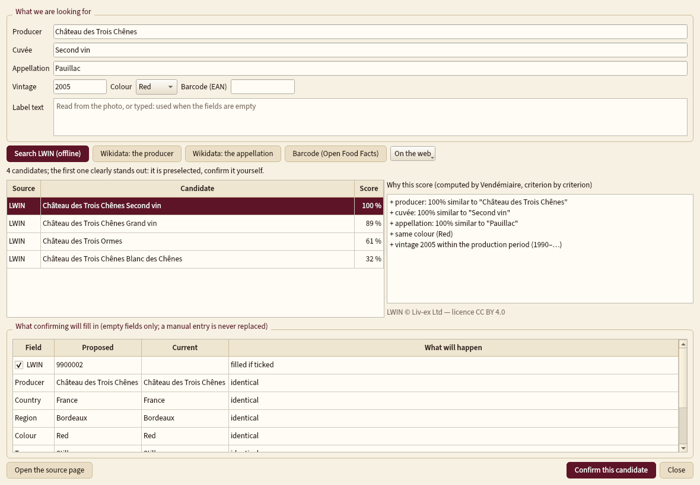
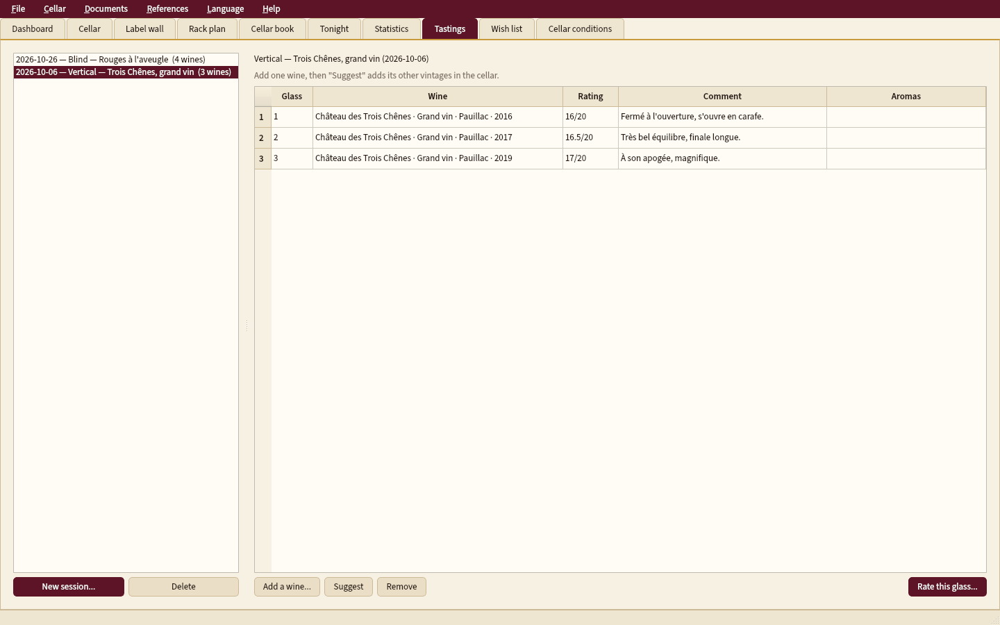

<p align="center"></p>

# Vendémiaire

**A complete, offline wine cellar manager**: every bottle, its place in the cellar, the cellar book of
ins and outs, when to open, how to serve and keep each wine, and food pairings, from sourced rules. French / English,
Windows, macOS and Linux. No data ever leaves the computer.

*Version française : [README.md](README.md).*

> **Status: phases 1 (foundations and cellar), 2 (world databases and labels) and 3 (drinking windows, serving, pairings), not released yet.** See [PROGRESSION.md](PROGRESSION.md) (in French).


## What phase 1 does

- **Cellar**: wines (producer, cuvée, appellation, region, country, colour, type, grapes with
  percentages, vintage, ABV, LWIN, barcode) and **individual bottles** — sizes from piccolo to
  Melchizedek, status (in cellar, awaiting delivery, en primeur, drunk, given away, sold, broken,
  corked), purchase price and place, dates, fill level (auction scale or in cm), label, capsule and
  cork condition, original wooden case, provenance.
- **Rack plan**: cellars › units › racks in rows and columns, several cellars; drag and drop a
  bottle (swap when the slot is taken), select several bottles and **move them as a batch**; every
  move is kept in the history.
- **Cellar book**: every in and out with occasion, guests, dish, score (out of 20, 100 or stars)
  and comment.
- **Wine sheet**: "cover" (label photo, or a drawn label), drinking windows (mine, critics'; the
  computed one comes in phase 3), critics' scores with their scale, dated and sourced value.
- **Dashboard**: bottles, litres, value paid and estimated, breakdowns, futures to be delivered,
  restock thresholds.
- **No locked-in data**: CSV export (one row per bottle) that re-imports losslessly, full JSON
  export, **CellarTracker** export import ([details, in French](docs/import_cellartracker.md)).
  An import never overwrites manually entered data.
- **Automatic backups** (at start-up, every 30 minutes when the database changed, on exit, before
  every import) with rotation; restore from the File menu.


## What phase 2 adds

- **World identifier**: local copy of **LWIN** (Liv-ex, CC BY 4.0) searched offline, **Wikidata**
  (producers, appellations, grapes), **Open Food Facts** (barcode); ranked candidates with an
  **explained score**, nothing written without confirmation, manual entries never replaced, log of
  what was filled in and from where.
- **Official appellation registers** (INAO, eAmbrosia) built in: completion and official spelling.
- **Label photos as covers**: automatic cropping and perspective correction, unwrapping, original
  kept, **label wall**, back label, capsule, case; **local OCR** (Tesseract) to identify a bottle
  from its photo.
- **Wish list**, **critics' scores** with a sourced conversion (Decanter table), **dated, sourced
  values**, **cellar conditions** (entry, CSV or Home Assistant import, curve), **stock-take**.




## What phase 3 adds

Every rule comes from the "Le vin" study (194 audited rules, 66 sources), copied unchanged with its
checksum; every result shows its **why**, its **sources** and its **confidence**
([details, in French](docs/regles_du_dossier.md)).

- **When to open**: drinking window, peak and summit, adjusted for the vintage and for the measured
  cellar temperature; three sources (mine, critic, computed); "drink this year", "declining", "too
  young" alerts; **cellar peak curve**: how many bottles to drink each year.
- **Serving**: temperature, when to take it out of the cellar, decanting, glass; printable
  **"tonight" sheet** (HTML or PDF).
- **Keeping**: cellar ranges, corks to check, **opened bottle** (how many days).
- **Fill levels**: illustrated scale and meaning for the wine's age.
- **Pairings** both ways and **"What to drink tonight?"** (dish, budget, colour, occasion).
- **Tasting notes** with the aroma wheel, **fault diagnosis** (corked, oxidised...).


## What phase 4 adds

Documents and statistics ([details, in French](docs/documents.md), [PDF examples](docs/exemples/)).

- **Fine-dining wine list** as a LaTeX PDF: classic order (sparkling → white → rosé → red → sweet →
  fortified; country, region, appellation, producer, vintage — never by price), BIN numbers, grouped
  verticals, by the glass, half bottles and large formats apart, favourites, tonight's menu with a wine
  suggested per dish, small region maps, index of producers; three templates (classic, modern, bistro),
  A4, A5 or single sheet, French or English; a saved list updates in one click. Without LaTeX, the same
  content is written by Qt.
- **Insurance / inventory report**: photo, fill level and its meaning, condition, case, provenance,
  dated and sourced value.
- **Statistics**: breakdowns (country, region, colour, grape, vintage, price...), value over time, bottles
  in versus out, drinking-window curve by colour.
- **QR codes and barcodes**: printable rack labels, reading from the webcam or a photo, taking a bottle
  out by scanning it.
- **Imports** from Excel and Vivino (column mapping), read-only **sharing** (HTML, PDF).
- **Tasting sessions**: vertical, horizontal, blind (rate before revealing).




## Run from source

```bash
python -m pip install -r requirements.txt
python run.py            # your cellar
python run.py --demo     # a demo cellar (made-up data)
python run.py --lang fr  # French interface
```

## Tests

```bash
xvfb-run -a python -m pytest -q tests/
```

## Licence

MIT — see [LICENSE](LICENSE). Embedded fonts under the SIL Open Font License.

Reference data: LWIN © Liv-ex Ltd (CC BY 4.0, not redistributed: imported by the user); INAO
(Licence Ouverte 2.0) and eAmbrosia (© European Union, reuse authorised) registers built in;
Wikidata (CC0); Open Food Facts (ODbL, photos CC BY-SA).
