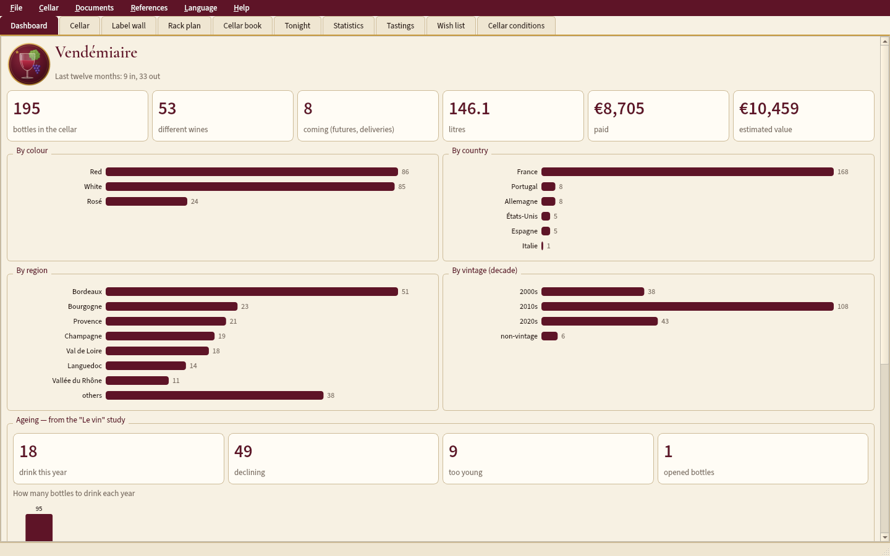
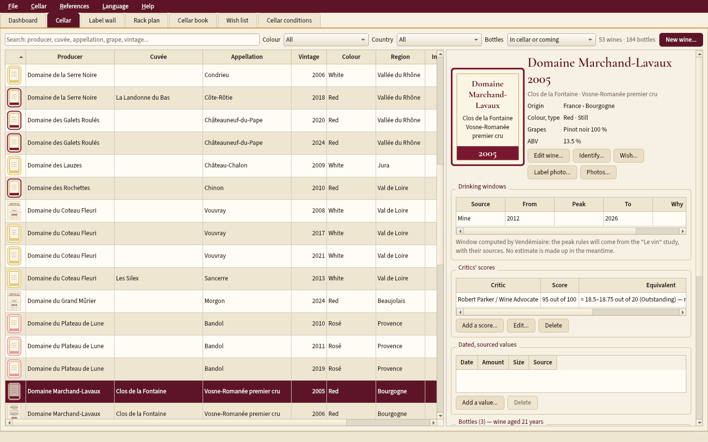
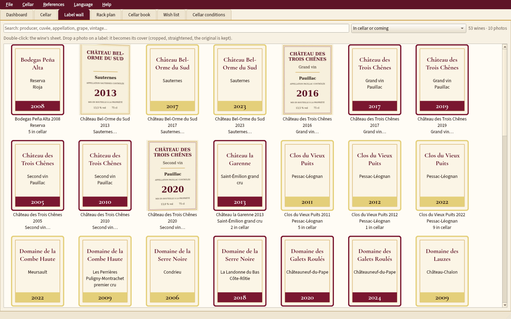
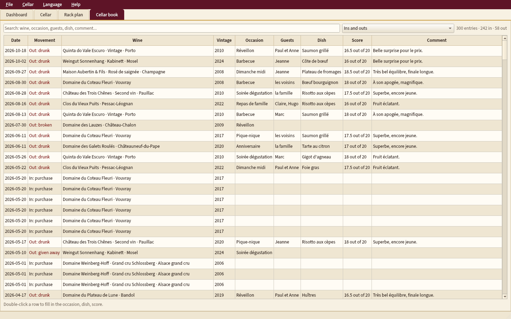
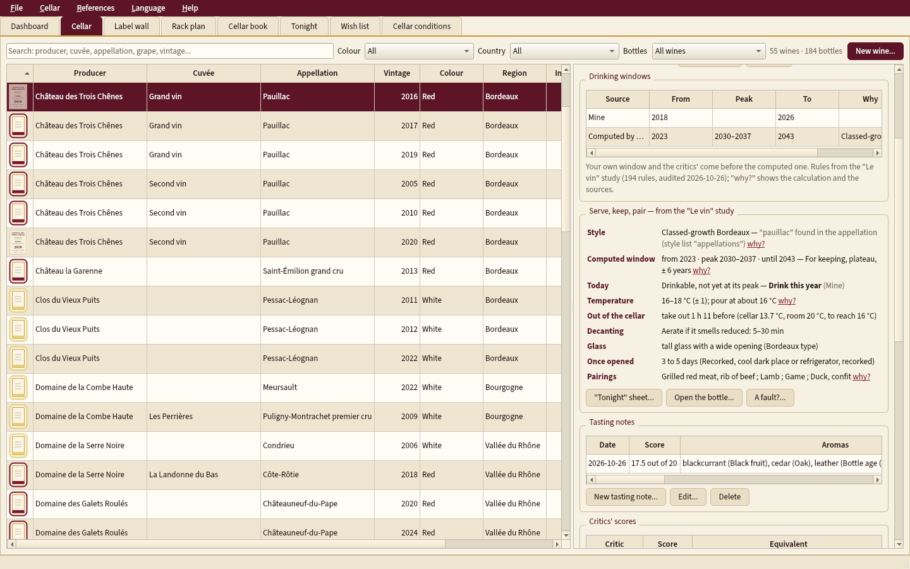
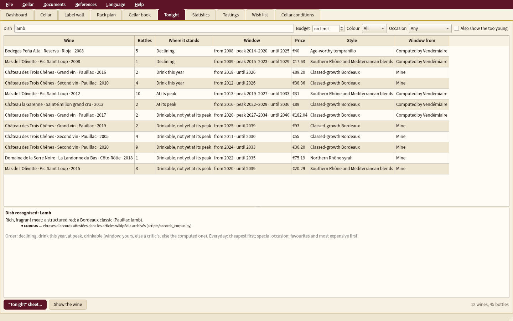
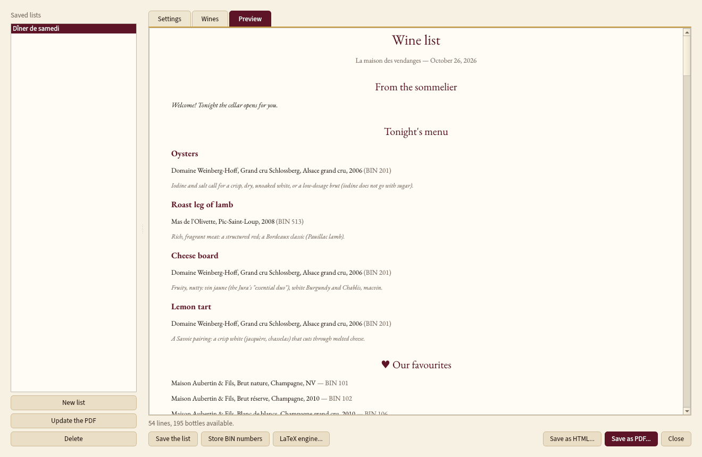
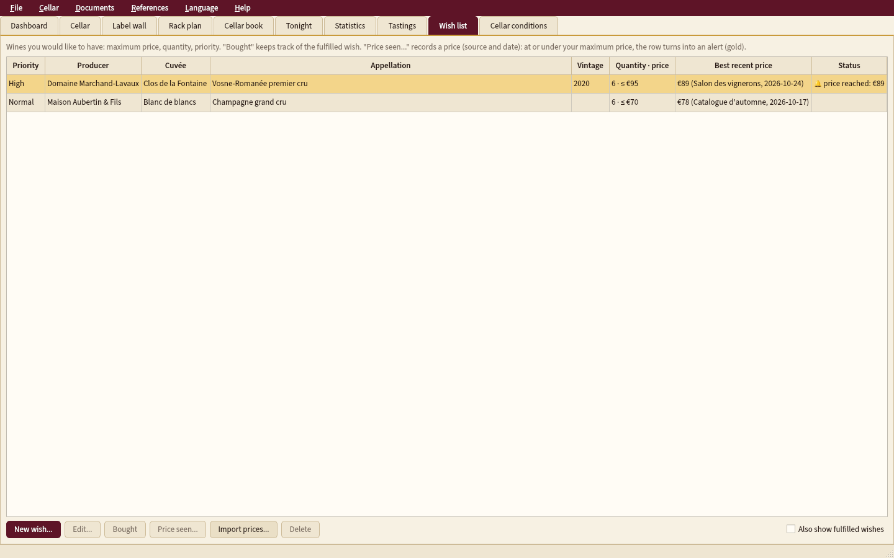
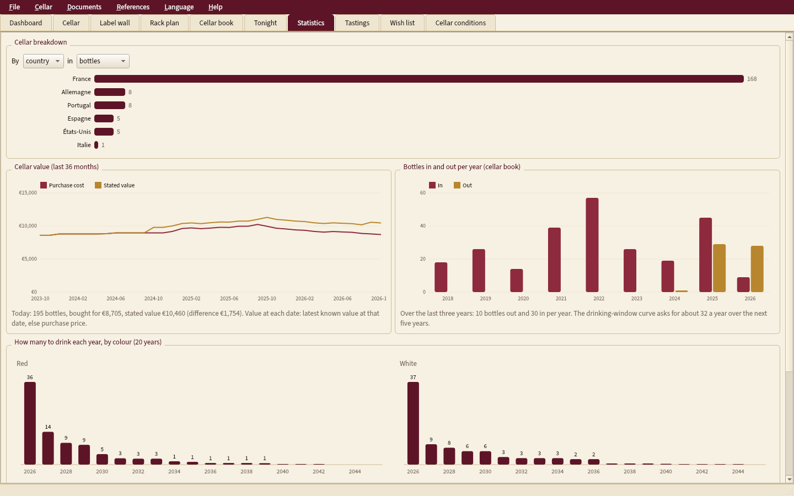

<p align="center"></p>

# Vendémiaire

**A complete, offline wine cellar manager**: every bottle and its place in the cellar, the cellar book of
everything in and out, when to open it, serving, storage and food pairing from sourced rules, a
"great restaurant" wine list, an insurance report, statistics. English / French; Windows, macOS and Linux.
No data ever leaves the computer.

*Version française : [README.md](README.md).*

**Version 1.0.6** — full manual: [English (PDF)](docs/manuel-en.pdf) · [French (PDF)](docs/manuel-fr.pdf) ·
changelog: [JOURNAL.md](JOURNAL.md) (in French).



## Install

On the repository's **Releases** page:

| System | File |
|---|---|
| Windows | `Vendemiaire-Setup.exe` (installs into your profile, no administrator password) |
| macOS Apple Silicon | `Vendemiaire-macos-arm64.dmg` |
| macOS Intel | `Vendemiaire-macos-x86_64.dmg` |
| Linux x86_64 / ARM64 | `Vendemiaire-linux-x86_64.tar.gz` / `Vendemiaire-linux-arm64.tar.gz`, then `./installer.sh` (no sudo) |

The package is self-contained (Python, Qt) and bundles **Tesseract** (label reading, French and English
models) and **Tectonic** (LaTeX PDFs) with a cache of LaTeX packages: everything works offline. The
application **updates itself** (it offers to at start-up); your data are never touched. Installers are
unsigned: Windows and macOS ask for confirmation the first time (see the manual).

## What Vendémiaire does

**The cellar**
- Wines (producer, cuvée, appellation, region, country, colour, type, grapes and percentages, vintage,
  alcohol, LWIN, barcode) and **individual bottles**: 20 formats from piccolo to melchizedek, status (in
  cellar, awaiting delivery, en primeur, drunk, given away, sold, broken, corked), purchase price and place,
  ullage (auction-house scale, illustrated), label/capsule/cork condition, original case, provenance, invoice.
- **Rack plan**: cellars › furniture › racks, drag and drop, swap, batch moves, history; keyboard too.
- **Cellar book**: occasion, guests, dish, score, comment, **moment photos**.
- **Label wall**: each label photo as a record sleeve; automatic cropping and straightening, **text reading
  (OCR)** to identify a bottle from its photo.

**Rules from the "Le vin" study** — 194 rules, 69 sources, audited; every answer gives its *why*, its sources
and its confidence ([details, in French](docs/regles_du_dossier.md)).
- **When to open**: window computed from the style, the vintage and the cellar's measured temperature (plus
  yours and the critics'); drink now / declining / too young alerts; drinking-window curve.
- **Serving** (temperature, when to take it out, decanting, glass, "tonight" sheet), **storage** (cellar
  conditions, corks, opened bottles), **ullage** by age, **pairings** both ways and "what to drink tonight?",
  **tasting** (aroma wheel; vertical, horizontal, blind sessions), **fault diagnosis**.

**World databases** ([details](docs/bases_mondiales.md)): **LWIN** identifier (local copy, offline search),
**Wikidata**, **Open Food Facts** (barcode), **INAO** and **eAmbrosia** registers; explained score, nothing
written without confirmation, hand-typed data never replaced; **whole-cellar identification at once**
(reliable matches ticked in advance, doubtful ones flagged, a single validation).

**Documents** ([details](docs/documents.md), [examples](docs/exemples/)): "great restaurant" **wine list**
(three designs, A4, A5 or single sheet, English or French, tonight's menu, small regional maps, one-click
update), **insurance report**, read-only **sharing**, **QR rack labels** and scanner, **shopping list**
(restock thresholds, wishes), **statistics**.

**Wishes and prices**: wish list, **price alerts** without scraping (prices seen, typed or imported).

**No data held hostage**: CSV, full JSON, **CellarTracker** ([details](docs/import_cellartracker.md)),
**Vivino** and Excel imports; automatic **backups**; database possibly in a **shared folder on a NAS** (single
writer, read-only readers, [stable export](docs/export_dossier.md)).










## Run from source

"`bash
python -m pip install -r requirements.txt
python run.py            # your cellar
python run.py --demo     # a demo cellar (invented data) — also: Help menu
python run.py --lang en  # English interface
```

From source, Tesseract and a LaTeX engine (Tectonic, XeLaTeX...) are looked for on the system; without a
LaTeX engine, documents are written by Qt (same content, simpler typography).

Data live outside the application folder: `%LOCALAPPDATA%\Vendemiaire` (Windows),
`~/Library/Application Support/Vendemiaire` (macOS), `~/.local/share/Vendemiaire` (Linux), or the folder
chosen with **File › Data folder...**.

## Tests

```bash
xvfb-run -a python -m pytest -q tests/
python outils/grosse_cave.py 20000   # interface timings on a 20,000-bottle cellar
python outils/manuel.py              # PDF manuals (Tectonic or XeLaTeX)
```

Model, migrations, imports/exports, interface (under Xvfb), bilingualism (no hard-coded text), rules,
documents, shared kit, privacy. Package builds really try the bundled tools (a QR code written then read,
a label read by Tesseract, a document compiled by Tectonic with no network).

## Licence and data sources

Vendémiaire: **MIT** ([LICENSE](LICENSE)). Bundled fonts (Source Sans 3, Cormorant Garamond): SIL Open Font
License.

| Source | Licence | Use |
|---|---|---|
| "Le vin" study | rules citing their sources (`vendemiaire/regles/donnees/sources.json`) | ageing, serving, storage, ullage, pairings |
| LWIN © Liv-ex Ltd | CC BY 4.0 — **not redistributed**: the user downloads it (Liv-ex form) and imports it | world identifier |
| Wikidata | CC0 | estates, appellations, grapes |
| Wikimedia Commons | each image's licence (stored with it) | estate images |
| Open Food Facts | ODbL (database), DbCL (contents), CC BY-SA (photos) | barcodes |
| INAO (data.gouv.fr) | Licence Ouverte 2.0 | appellation register (bundled) |
| eAmbrosia | © European Union, reuse authorised (Decision 2011/833/EU) | appellation register (bundled) |
| Natural Earth | public domain | small regional maps |
| Tesseract + tessdata_fast | Apache 2.0 | OCR (bundled) |
| Tectonic | MIT; LaTeX packages in its cache under their own licences (LPPL, OFL...) | PDFs (bundled) |
| Qt / PyQt6, segno, zxing-cpp | LGPL v3 / GPL v3, BSD, Apache 2.0 | interface, QR codes and barcodes |

The demo's photos and labels are drawn by the application; its producers are invented.
