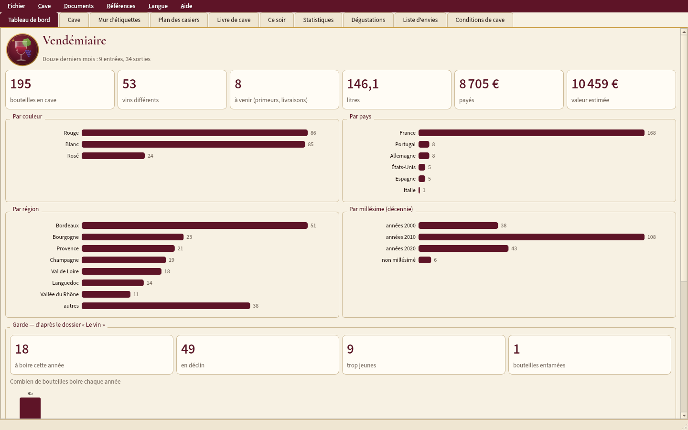
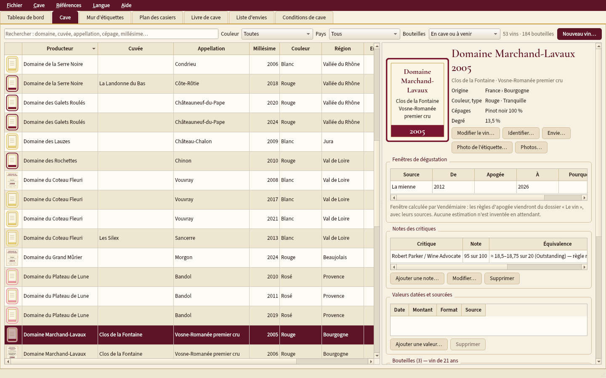
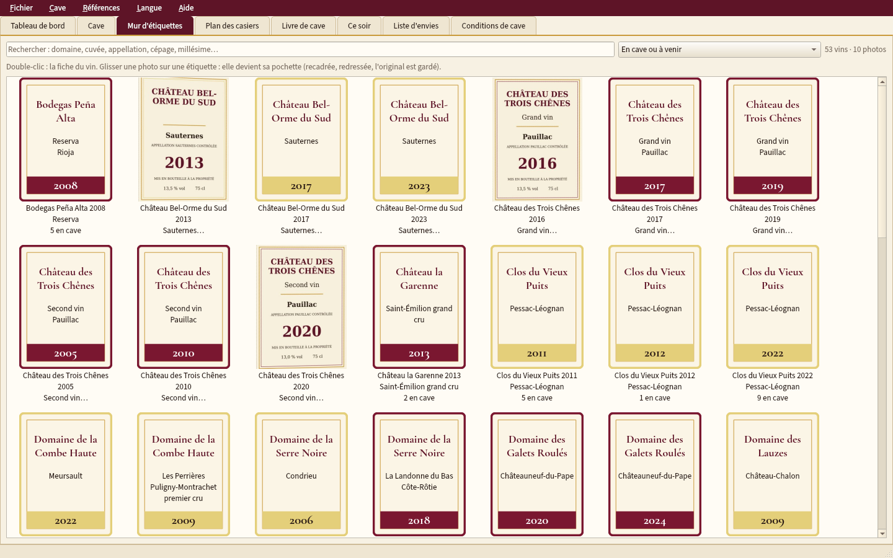
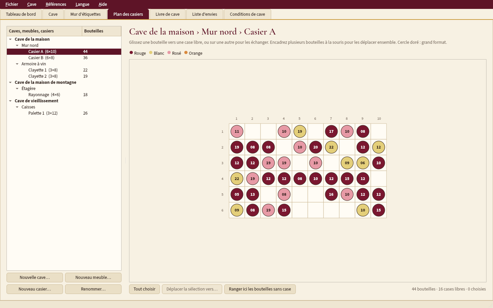
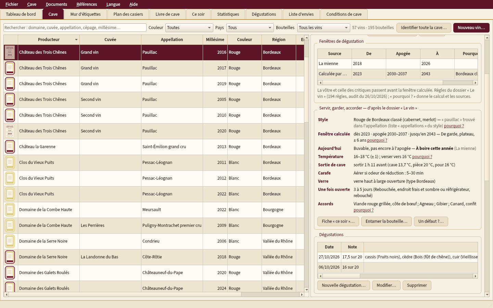
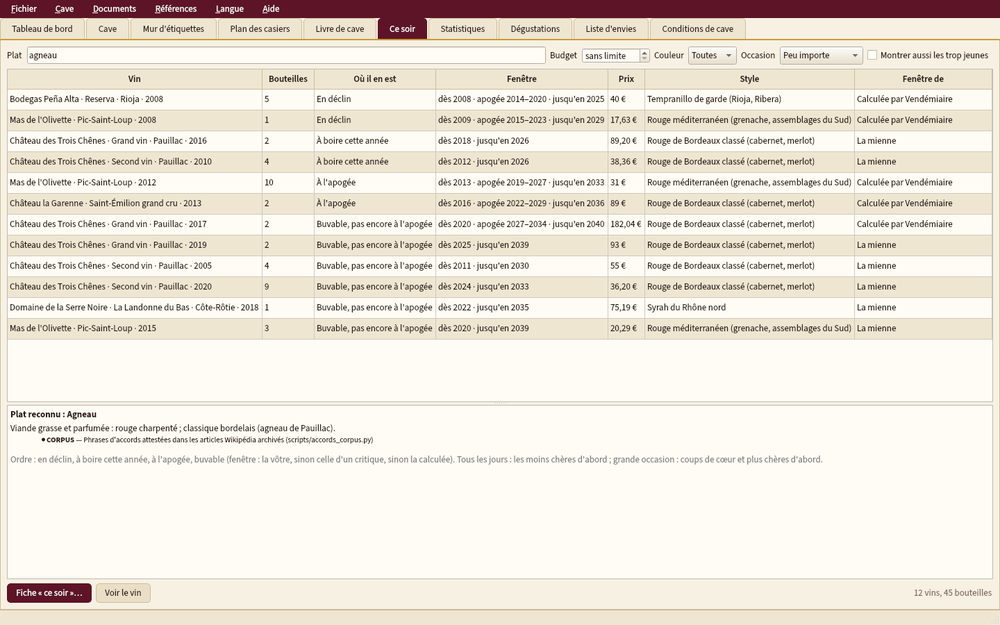
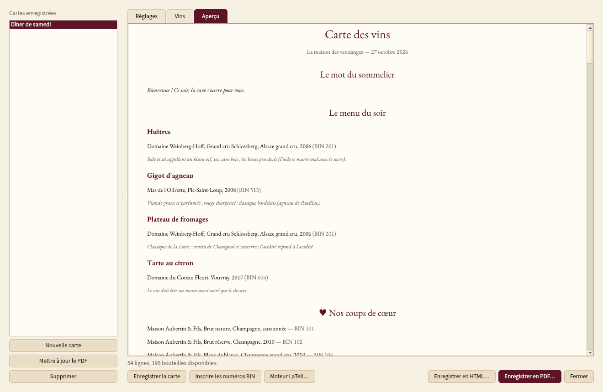
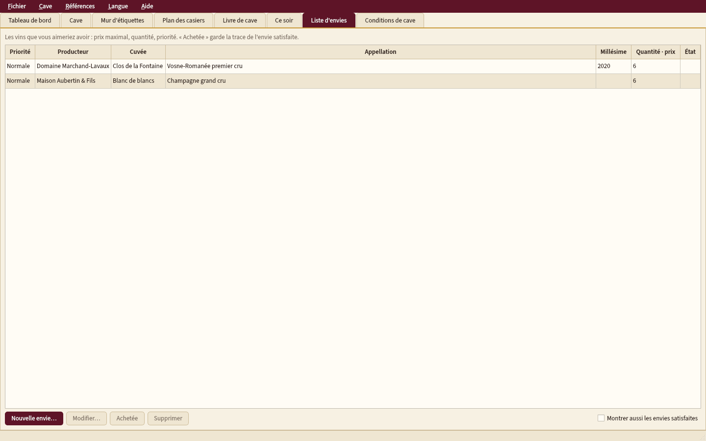
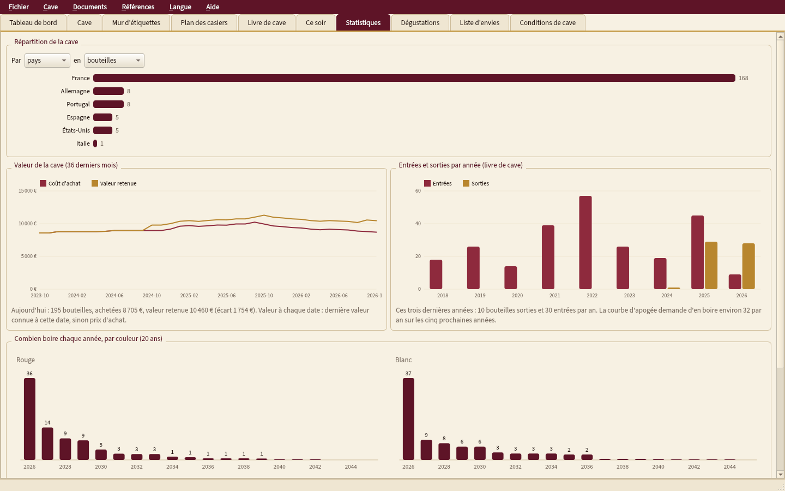

<p align="center"></p>

# Vendémiaire

**Gestion de cave à vin, complète et hors ligne** : chaque bouteille et sa place dans la cave, le livre de
cave des entrées et sorties, la date d'ouverture, le service, la conservation et les accords mets-vins
d'après des règles sourcées, une carte des vins « de grand restaurant », un rapport d'assurance, des
statistiques. Bilingue français / anglais ; Windows, macOS et Linux. Aucune donnée ne quitte l'ordinateur.

*English version: [README.en.md](README.en.md).*

**Version 1.0.5** — manuel complet : [français (PDF)](docs/manuel-fr.pdf) · [anglais (PDF)](docs/manuel-en.pdf) ·
journal : [JOURNAL.md](JOURNAL.md).



## Installer

Sur la page **Releases** du dépôt :

| Système | Fichier |
|---|---|
| Windows | `Vendemiaire-Setup.exe` (installation dans le profil, sans mot de passe administrateur) |
| macOS Apple Silicon | `Vendemiaire-macos-arm64.dmg` |
| macOS Intel | `Vendemiaire-macos-x86_64.dmg` |
| Linux x86_64 / ARM64 | `Vendemiaire-linux-x86_64.tar.gz` / `Vendemiaire-linux-arm64.tar.gz`, puis `./installer.sh` (sans sudo) |

Le paquet est autonome (Python, Qt) et embarque **Tesseract** (lecture des étiquettes, modèles français et
anglais) et **Tectonic** (PDF LaTeX) avec un cache de paquets LaTeX : tout fonctionne hors ligne.
L'application se **met à jour toute seule** (elle le propose au démarrage) ; vos données ne sont jamais
touchées. Les installeurs ne sont pas signés : Windows et macOS demandent une confirmation la première fois
(voir le manuel).

## Ce que fait Vendémiaire

**La cave**
- Vins (producteur, cuvée, appellation, région, pays, couleur, type, cépages et pourcentages, millésime,
  degré, LWIN, code-barres) et **bouteilles individuelles** : 20 formats de la piccolo au melchisédech, statut
  (en cave, en attente, primeur, bue, offerte, vendue, cassée, bouchonnée), prix et lieu d'achat, niveau
  (échelle des ventes aux enchères, illustrée), état de l'étiquette, de la capsule et du bouchon, caisse
  d'origine, provenance, facture.
- **Plan des casiers** : caves › meubles › casiers, glisser-déposer, échange, déplacement en lot, historique ;
  au clavier aussi.
- **Livre de cave** : occasion, convives, plat, note, commentaire, **photos du moment**.
- **Mur d'étiquettes** : la photo de chaque étiquette comme une pochette de disque ; recadrage et
  redressement automatiques, **lecture du texte (OCR)** pour identifier une bouteille d'après sa photo.

**Les règles du dossier « Le vin »** — 194 règles, 69 sources, auditées ; chaque réponse dit son *pourquoi*,
ses sources et sa confiance ([détails](docs/regles_du_dossier.md)).
- **Date d'ouverture** : fenêtre calculée selon le style, le millésime et la température mesurée de la cave
  (et la vôtre, et celle des critiques) ; alertes à boire, en déclin, trop jeune ; courbe d'apogée.
- **Servir** (température, heure de sortie de cave, carafe, verre, fiche « ce soir »), **conserver**
  (conditions de cave, bouchons, bouteille entamée), **niveaux** selon l'âge, **accords** dans les deux sens et
  « que boire ce soir ? », **dégustation** (roue des arômes, séances verticales, horizontales, à l'aveugle),
  **diagnostic** des défauts.

**Bases mondiales** ([détails](docs/bases_mondiales.md)) : identifiant **LWIN** (copie locale, recherche hors
ligne), **Wikidata**, **Open Food Facts** (code-barres), registres **INAO** et **eAmbrosia** ; score expliqué,
rien n'est écrit sans confirmation, une saisie à la main n'est jamais remplacée ; **identification de toute
la cave d'un coup** (décisions sûres cochées d'avance, douteuses signalées, une seule validation).

**Documents** ([détails](docs/documents.md), [exemples](docs/exemples/)) : **carte des vins** « de grand
restaurant » (trois modèles, A4, A5 ou carte simple, français ou anglais, menu du soir, petites cartes des
régions, mise à jour d'un clic), **rapport d'assurance**, **partage** en lecture seule, **étiquettes de casier
à code QR** et scanner, **liste d'achats** (seuils de réassort, envies), **statistiques**.

**Envies et prix** : liste d'envies, **alertes de prix** sans aspirateur (prix vus saisis ou importés).

**Aucune donnée prisonnière** : CSV, JSON complet, imports **CellarTracker** ([détails](docs/import_cellartracker.md)),
**Vivino**, Excel ; **sauvegardes** automatiques ; base possible dans un **dossier partagé sur un NAS** (un seul
écrivain, lecteurs en lecture seule, [export stable](docs/export_dossier.md)).










## Lancer depuis les sources

```bash
python -m pip install -r requirements.txt
python run.py            # votre cave
python run.py --demo     # une cave de démonstration (données inventées) — aussi : menu Aide
python run.py --lang en  # interface anglaise
```

Depuis les sources, Tesseract et un moteur LaTeX (Tectonic, XeLaTeX…) sont cherchés sur le système ; sans
moteur LaTeX, les documents sont écrits par Qt (même contenu, typographie plus simple).

Les données vivent hors du dossier de l'application : `%LOCALAPPDATA%\Vendemiaire` (Windows),
`~/Library/Application Support/Vendemiaire` (macOS), `~/.local/share/Vendemiaire` (Linux), ou le dossier
choisi par **Fichier › Dossier des données…**.

## Essais

```bash
xvfb-run -a python -m pytest -q tests/
python outils/grosse_cave.py 20000   # temps de l'interface sur une cave de 20 000 bouteilles
python outils/manuel.py              # manuels PDF (Tectonic ou XeLaTeX)
```

Modèle, migrations, imports/exports, interface (sous Xvfb), bilinguisme (aucun texte en dur), règles,
documents, kit commun, confidentialité. La construction des paquets essaie pour de vrai les outils
embarqués (code QR écrit puis relu, étiquette lue par Tesseract, document compilé par Tectonic sans réseau).

## Licence et sources de données

Vendémiaire : **MIT** ([LICENSE](LICENSE)). Polices embarquées (Source Sans 3, Cormorant Garamond) : SIL Open
Font License.

| Source | Licence | Usage |
|---|---|---|
| Dossier « Le vin » | règles citant leurs sources (`vendemiaire/regles/donnees/sources.json`) | garde, service, conservation, niveaux, accords |
| LWIN © Liv-ex Ltd | CC BY 4.0 — **non redistribué** : l'utilisateur le télécharge (formulaire de Liv-ex) et l'importe | identifiant mondial |
| Wikidata | CC0 | domaines, appellations, cépages |
| Wikimedia Commons | licence de chaque image (enregistrée avec elle) | images de domaines |
| Open Food Facts | ODbL (base), DbCL (contenus), CC BY-SA (photos) | code-barres |
| INAO (data.gouv.fr) | Licence Ouverte 2.0 | registre des appellations (embarqué) |
| eAmbrosia | © Union européenne, réutilisation autorisée (décision 2011/833/UE) | registre des appellations (embarqué) |
| Natural Earth | domaine public | petites cartes des régions |
| Tesseract + tessdata_fast | Apache 2.0 | OCR (embarqué) |
| Tectonic | MIT ; paquets LaTeX de son cache sous leurs licences (LPPL, OFL…) | PDF (embarqué) |
| Qt / PyQt6, segno, zxing-cpp | LGPL v3 / GPL v3, BSD, Apache 2.0 | interface, codes QR et codes-barres |

Les photos et étiquettes de la démonstration sont dessinées par l'application ; ses producteurs sont inventés.
