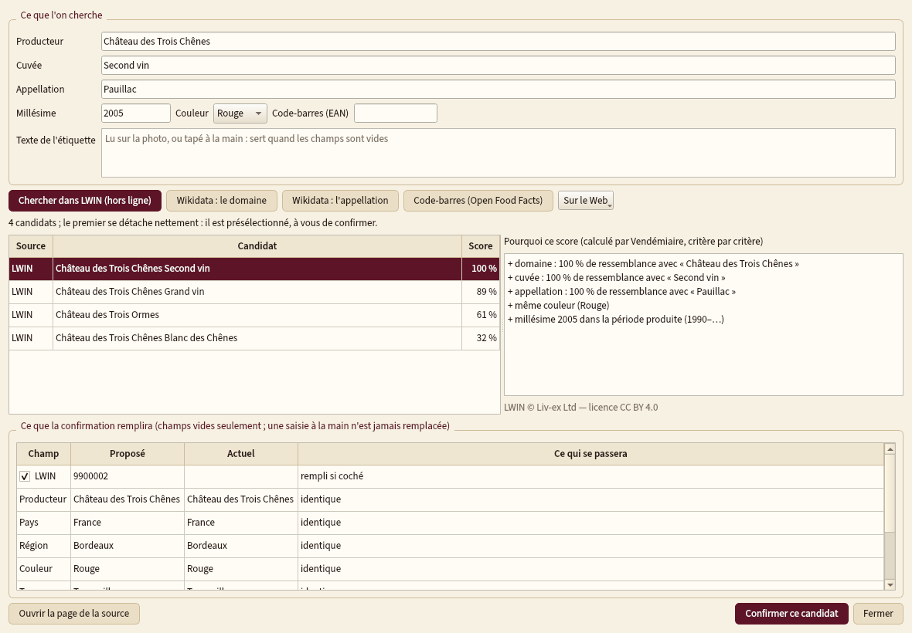
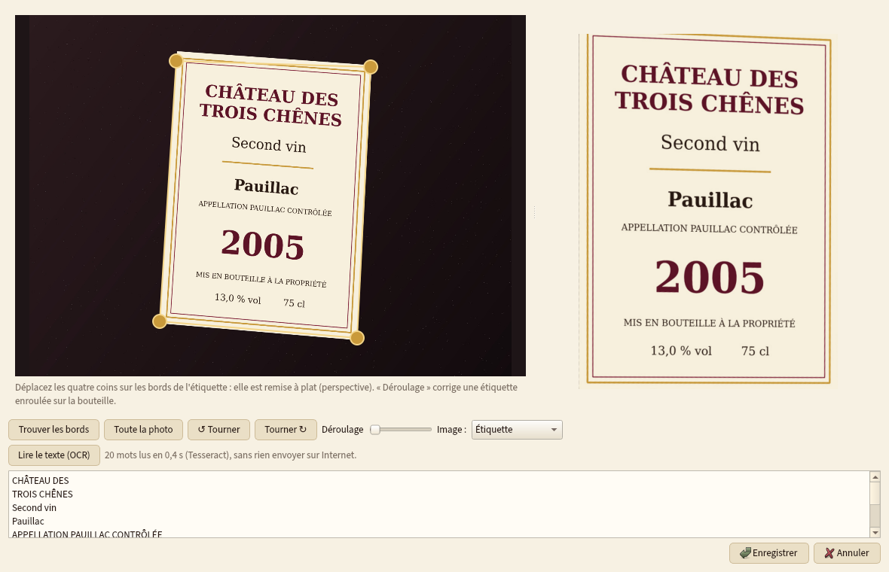

<p align="center"></p>

# Vendémiaire

**Gestion de cave à vin, complète et hors ligne** : chaque bouteille, son emplacement dans la cave, le
livre de cave des entrées et sorties, et bientôt l'apogée, le service et les accords mets-vins.
Bilingue français / anglais, Windows, macOS et Linux. Aucune donnée ne quitte l'ordinateur.

*English version: [README.en.md](README.en.md).*

> **État : phases 1 (socle et cave) et 2 (bases mondiales et étiquettes), pas encore publiées.** Voir [PROGRESSION.md](PROGRESSION.md).


## Ce que fait la phase 1

- **Cave** : vins (producteur, cuvée, appellation, région, pays, couleur, type, cépages et
  pourcentages, millésime, degré, LWIN, code-barres) et **bouteilles individuelles** — format de la
  piccolo au melchisédech, statut (en cave, en attente de livraison, primeur, bue, offerte, vendue,
  cassée, bouchonnée), prix et lieu d'achat, dates, niveau (échelle des ventes aux enchères ou en cm),
  état de l'étiquette, de la capsule et du bouchon, caisse bois d'origine, provenance.
- **Plan des casiers** : caves › meubles › casiers en rangées et colonnes, plusieurs caves ;
  glisser-déposer d'une bouteille (échange si la case est prise), sélection de plusieurs bouteilles
  et **déplacement en lot** ; chaque déplacement est gardé dans l'historique.
- **Livre de cave** : toutes les entrées et sorties avec l'occasion, les convives, le plat, la note
  (sur 20, 100 ou en étoiles) et le commentaire.
- **Fiche du vin** : « pochette » (photo de l'étiquette, ou étiquette dessinée), fenêtres de
  dégustation (la mienne, celles des critiques ; celle calculée viendra en phase 3), notes des
  critiques avec leur échelle, valeur datée et sourcée.
- **Tableau de bord** : bouteilles, litres, valeur payée et estimée, répartitions, primeurs à livrer,
  seuils de réassort.
- **Aucune donnée prisonnière** : export CSV (une ligne par bouteille) qui se réimporte sans perte,
  export JSON complet, import d'un export **CellarTracker** ([détails](docs/import_cellartracker.md)).
  Un import ne remplace jamais une saisie manuelle.
- **Sauvegardes automatiques** (au démarrage, toutes les 30 minutes si la base a changé, à la
  fermeture, avant chaque import) avec rotation ; restauration depuis le menu Fichier.


## Ce qu'ajoute la phase 2

- **Identifiant mondial** : copie locale de **LWIN** (Liv-ex, CC BY 4.0) cherchée hors ligne,
  **Wikidata** (domaines, appellations, cépages), **Open Food Facts** (code-barres) ; candidats
  classés avec un **score expliqué**, rien n'est écrit sans confirmation, une saisie à la main n'est
  jamais remplacée, journal de ce qui a été rempli et d'où ([détails](docs/bases_mondiales.md)).
- **Registres officiels des appellations** (INAO, eAmbrosia) embarqués : complétion et orthographe
  officielle proposée à la saisie.
- **Photos d'étiquette = pochettes** : recadrage et redressement automatiques, déroulage, original
  gardé, **mur d'étiquettes**, contre-étiquette, capsule, caisse ; **OCR local** (Tesseract) pour
  identifier une bouteille d'après sa photo ([détails](docs/photos_et_ocr.md)).
- **Liste d'envies**, **notes des critiques** avec conversion sourcée (table Decanter du dossier
  « Le vin »), **valeurs datées et sourcées**, **conditions de cave** (saisie, import CSV ou Home
  Assistant, courbe), **inventaire de contrôle**.





## Lancer depuis les sources

```bash
python -m pip install -r requirements.txt
python run.py            # votre cave
python run.py --demo     # une cave de démonstration (données inventées)
python run.py --lang en  # interface anglaise
```

Les données vivent hors du dossier de l'application : `%LOCALAPPDATA%\Vendemiaire` (Windows),
`~/Library/Application Support/Vendemiaire` (macOS), `~/.local/share/Vendemiaire` (Linux). Le menu
**Fichier › Dossier des données…** permet de les poser ailleurs, par exemple sur un lecteur réseau ;
une seule copie de Vendémiaire à la fois peut alors écrire, les autres programmes lisent en lecture
seule ([export stable](docs/export_dossier.md)).

## Essais

```bash
xvfb-run -a python -m pytest -q tests/
```

Modèle, migrations du schéma, imports/exports, interface (sous Xvfb), bilinguisme (aucun texte en
dur), kit commun et confidentialité.

## Licence

MIT — voir [LICENSE](LICENSE). Polices embarquées sous SIL Open Font License.

Données de référence : LWIN © Liv-ex Ltd (CC BY 4.0, non redistribuée : importée par l'utilisateur) ;
registres INAO (Licence Ouverte 2.0) et eAmbrosia (© Union européenne, réutilisation autorisée)
embarqués dans `vendemiaire/donnees/` ; Wikidata (CC0) ; Open Food Facts (ODbL, photos CC BY-SA) ;
règle de conversion des notes : dossier « Le vin » (`vendemiaire/regles/donnees/`).
